<h3 align="center">第99話 ・ the red teamer who kept building the walls</h3>

<i>offensive security by day ・ agent guardrails by night ・ a few bots that never sleep</i>

---

#### 📺 Now Airing

**EP.01 ・ [Clearance](https://github.com/yuzuru99/hermes-clearance)**

Drop an AI agent into a group chat and every member suddenly holds the same keys, shell included. Clearance hands each person their own tier for [Hermes Agent](https://github.com/NousResearch/hermes-agent) and enforces it in code on every single tool call. Talking your way into "owner" doesn't work here; I tried. ([trailer](https://x.com/agungkzn/status/2119295704380461076))

#### 🎬 Behind the Scenes

Episodes that don't air publicly, but keep running in the background:

- ⚔️ **Red-team arc** — finding the way in, writing it up, then helping close it.
- 📈 **Market arc** — perp-DEX trading engines that have to survive paper trading before they're trusted with anything real.
- 🤖 **Familiar arc** — small bots on Telegram and Discord that do one job well.

#### 🎌 Staff

`Python` ・ `TypeScript` ・ `Linux` ・ `Docker` ・ `LLM red teaming` ・ `too many cron jobs`

 

— to be continued ▶ —

